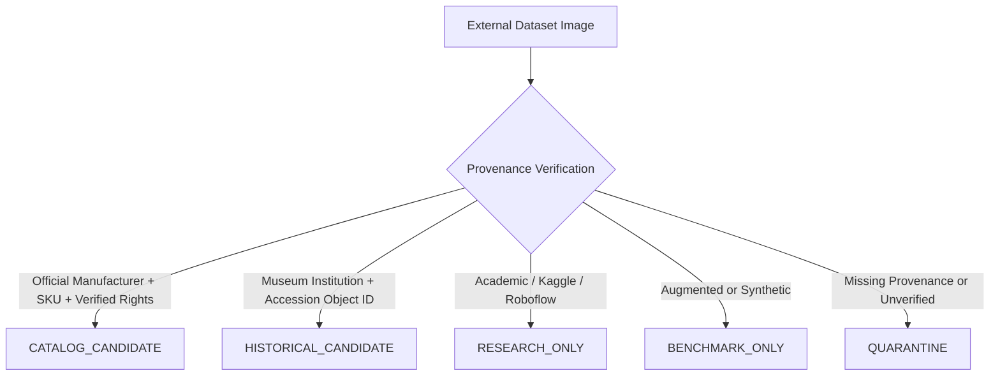

# External Carpet Dataset Intake & Governance Protocol

## 1. Overview & Architectural Philosophy

The Carpet Style & Story Match platform distinguishes strictly between **commercial product catalog data**, **authenticated museum/archive historical heritage references**, and **external ML research / benchmark image datasets**.

To preserve system integrity, prevent catalog pollution, and enforce ethical dataset governance, external image corpora imported from Kaggle, Roboflow, academic repositories, or museum open access APIs pass through a **provenance-first intake and classification pipeline**.

---

## 2. Fundamental Invariants

- **DATASET IMAGE != CATALOG PRODUCT**: External research images never automatically populate `CarpetModel(source_type=CATALOG)`.
- **PROVENANCE-BASED CATALOG ELIGIBILITY**: Pixel similarity, white backgrounds, or CLIP embeddings can NEVER designate an image as a commercial catalog product.
- **OFFICIAL SKU IS MANDATORY**: Missing official manufacturer SKU strictly blocks catalog candidacy (`CatalogEligibility.INELIGIBLE`).
- **PROHIBITION OF AUGMENTED/SYNTHETIC PROMOTION**: Augmented or AI-generated images are classified as `BENCHMARK_ONLY` and prohibited from entering production catalog or historical databases.
- **LICENSE GATE**: Unverified licensing (`license_verified: false`) prevents automated promotion.

---

## 3. Five-Tier Role Classification

1. **`CATALOG_CANDIDATE`**: Verified commercial products from official carpet manufacturers with non-empty SKU, valid product URL, and verified commercial rights.
2. **`HISTORICAL_CANDIDATE`**: Original museum or archival accession photographs with verified object-level institutional provenance (institution name, stable accession object ID, and official institutional source URL). Dataset names, folder names, or source labels (e.g. "Safavid") alone NEVER qualify a record as a historical candidate.
3. **`RESEARCH_ONLY`**: Academic computer vision corpora, Kaggle datasets, and pattern family collections used exclusively for offline distribution study and feature exploration.
4. **`BENCHMARK_ONLY`**: Transformed, augmented, cropped, or synthetic images intended solely for algorithm robustness testing.
5. **`QUARANTINE`**: Records with ambiguous provenance, missing original URLs, or unverified license terms.

---

## 4. Source Label Namespacing & Taxonomy

All external dataset labels are namespaced to prevent semantic collision (e.g., `iranian-patterns:Afshan` vs `generic-rugs:Afshan`). Source labels are kept distinct from canonical system taxonomies until human curators confirm mapping.

---

## 5. Deduplication & Audit Integrity

Every valid image file generates a SHA-256 hash upon intake. Exact duplicate hashes across datasets are recorded in audit manifests without automated file deletion, preserving full provenance lineage.

---

## 6. Boundary with Task POST-v1 A3

Dataset intake and inspection operates in pure metadata/manifest mode. **No database mutations occur during inspection**, and **Style DNA batch analysis (Task A3) is NOT executed**.
